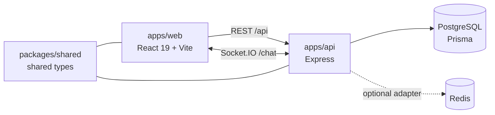

# live-chat

A real-time chat built as a production-minded monorepo: secure sessions, channels with invitations, presence and read receipts over Socket.IO, backed by PostgreSQL and an optional Redis adapter for horizontal scaling.

## Features

- **Secure sessions.** Short-lived access tokens plus long-lived **rotating refresh tokens**, stored hashed in the database and sent only in an `HttpOnly` cookie, so JavaScript never sees them. Logout revokes the current token.
- **Channels.** Public and private channels, discovery search, invitations by username or email, and owner-managed join requests.
- **Real-time messaging.** Socket.IO namespace with typing indicators, presence, system messages and **delivered/read receipts**.
- **Reliable writes.** **Idempotent message sends**, so a retried request never duplicates a message, and cursor-based pagination of history.
- **Scales out.** Optional **Redis adapter** to share real-time state across API instances.
- **Hardened.** Rate limiting on the REST API (stricter on auth) and per-event limits on the socket, uniform JSON errors, and `/health` (liveness) and `/readyz` (readiness, checks the database and Redis) endpoints.

## Architecture



## Stack

| Layer | Tech |
| --- | --- |
| Frontend | React 19, Vite, TypeScript, socket.io-client |
| Backend | Node.js, Express, Socket.IO, TypeScript |
| Data | PostgreSQL 17, Prisma, Redis 7 (optional) |
| Tooling | pnpm workspaces, Docker Compose, GitHub Actions |
| Testing | Vitest for the API (REST and sockets), Playwright for end-to-end |

## Testing

- **API:** suites for auth, channels, messages, socket events, readiness and rate limiting (`apps/api/tests`).
- **End-to-end:** a Playwright flow from a signed-out session to login and conversation navigation, with the API mocked so it runs without a database (`apps/web/e2e`).
- **CI:** every push and pull request to `main` installs, generates the Prisma client, runs the migrations against a Postgres service, typechecks and runs the API tests.

## Run locally

Requirements: Node 20+, pnpm 10 and Docker.

```bash
pnpm install
cp apps/api/.env.example apps/api/.env

pnpm db:up                       # PostgreSQL on localhost:5433
docker compose up -d redis       # optional, set REDIS_ENABLED=true to use it

pnpm --filter @live-chat/api prisma:migrate --name init
pnpm --filter @live-chat/api prisma:generate

pnpm dev                         # web on :5173, API on :4000
```

Tests:

```bash
pnpm test:api
pnpm --filter @live-chat/web exec playwright install chromium
pnpm test:e2e:web
```

<details>
<summary><b>API reference</b></summary>

### Auth

- `POST /api/auth/register`
- `POST /api/auth/login`
- `POST /api/auth/refresh` (refresh token from the `HttpOnly` cookie)
- `POST /api/auth/logout` (revokes the current refresh token and clears the cookie)
- `GET /api/auth/me` (Bearer token)

### Channels

- `GET /api/channels`
- `GET /api/channels/discover?query=<text>`
- `POST /api/channels` with `{ "name": "general", "visibility": "PUBLIC" | "PRIVATE" }`
- `POST /api/channels/:channelId/invitations` (owner of a private channel) with `{ "username": "..." }` or `{ "email": "..." }`
- `POST /api/channels/:channelId/invitations/accept`
- `POST /api/channels/:channelId/join` (public: direct join; private: needs a pending invitation)
- `GET /api/channels/:channelId/members`
- `GET /api/channels/:channelId/requests` (owner)
- `POST /api/channels/:channelId/requests/:requestId/approve` (owner)
- `POST /api/channels/:channelId/requests/:requestId/deny` (owner)

### Messages and presence

- `GET /api/channels/:channelId/messages?cursor=<messageId>&limit=30[&conversationId=<id>]`
- `POST /api/channels/:channelId/messages` with `{ "body": "hi", "conversationId"?: "..." }`
- `POST /api/channels/:channelId/messages/:messageId/receipt` with `{ "status": "DELIVERED" | "READ" }`
- `GET /api/conversations/:conversationId/messages?cursor=<messageId>&limit=30`
- `POST /api/conversations/:conversationId/messages` with `{ "body": "hi" }`
- `GET /api/presence?channelId=<id>`

All of them except register, login and refresh need a Bearer token, and channel routes need membership.

### Socket.IO

Namespace `/chat`, authenticated in the handshake with `auth: { token: <JWT> }`.

- Client → server: `channel:join`, `message:send`, `message:receipt`, `typing:start`, `typing:stop`
- Server → client: `channel:joined`, `message:new`, `message:receipt:update`, `presence:update`, `typing:update`, `system:message`

### Operations

- `GET /health`: process liveness, no dependency checks.
- `GET /readyz`: readiness for traffic gating; checks the database, and Redis when `REDIS_ENABLED=true`.

</details>

## License

[MIT](LICENSE) © Diego Rangel
